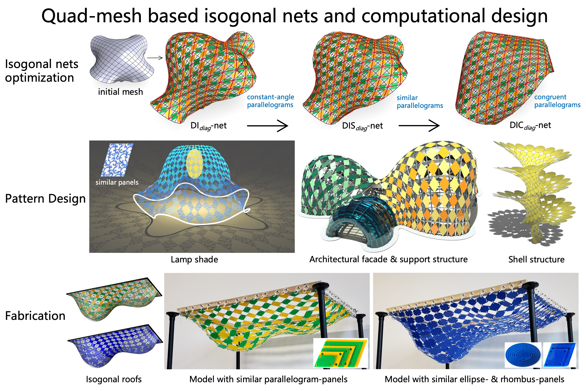

------

##### <i class='fas fa-folder-open'>**Publication**</i> 
The paper has been accepted for presentation at the [SIGGRAPH (Asia) 2026](https://sa2026.conference-schedule.org/presentation/?id=papers_2209&sess=sess117) conference in Kuala Lumpur, Malaysia :palm_tree: from Decemeber 1 to 4, 2026.

It is published in the [ACM Transactions on Graphics (TOG)](https://dl.acm.org/doi/abs/10.1145/3842568) journal.

##### <i class='fas fa-laugh-beam'>**Authors**</i> 
Hui Wang* (corresponding author), Yongxiang Tan

##### <i class='fas fa-align-justify'>**Abstract**</i>
We propose a quad-mesh-based framework for discrete isogonal nets using checkerboard patterns with inscribed parallelograms derived from quad meshes. By controlling the angles, similarity, or congruence of these parallelograms, we obtain three classes of isogonal nets on diagonal or control meshes. These nets admit simple explicit representations, enable diverse shape exploration related to conformal mappings with preserved pattern shapes, and support efficient computation and optimization. The third class serves as a discrete model of developable surfaces, grounded in our analysis of smooth isogonal Chebyshev nets and verified through discrete differential geometric quantities. We demonstrate the effectiveness of the three proposed nets through pattern designs for shell structures and interactive paper-cutting models, both fabricated with repetitive similar elements.

------

##### <i class='fas fa-file-pdf'>**PDF**</i>
[paper](/assets/pdf/2026SIGA.pdf)

<iframe src="/assets/pdf/2026SIGA.pdf#toolbar=0" 
width="100%" height=800 frameborder="0" style="border: none;">
</iframe>

##### <i class='fas fa-file-pdf'>**Slide**</i>
Check the [Published Webpage](https://dl.acm.org/doi/abs/10.1145/3842568) or another [Project webpage](https://yxtan-xjtu.github.io/isogonal-nets/#video).

#### <i class='fas fa-photo-video'>Video</i>
Check the [Published Webpage](https://dl.acm.org/doi/abs/10.1145/3842568) or another [Project webpage](https://yxtan-xjtu.github.io/isogonal-nets/#video).

#### <i class='fa fa-code'>Code</i>
Check the [Published Webpage](https://dl.acm.org/doi/abs/10.1145/3842568) or another [Project webpage](https://yxtan-xjtu.github.io/isogonal-nets/#video).